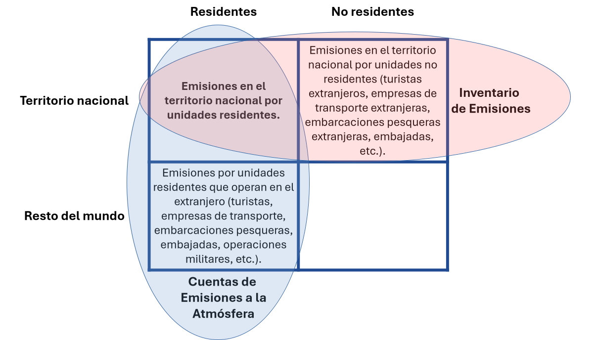

```{r}
#| label: datos
library(ggplot2)

# Anexo E de Yamano y Guilhoto (2020)
oecd <- data.frame(
  pais = c("Perú", "Chile", "Colombia", "México", "Argentina", "Brasil", "Costa Rica"),
  ext_2005 = c(32.4, 39.4, 29.6, 22.7, 16.7, 20.4, 49.8),
  ext_2015 = c(36.6, 36.0, 34.0, 26.9, 18.3, 21.7, 52.1)
)
```

## Temas a tratar {.theme-content}

1.  Qué es una huella de carbono.
2.  Cómo se calcula.
3.  Para qué sirve.
4.  Qué dicen los datos globales y de América Latina.
5.  Experiencias internacionales: Reino Unido, Unión Europea, OCDE, bases multirregionales y América Latina.
6.  Lecciones y decisiones de diseño.
7.  Anexo: el contexto de la misión en Perú.

# Qué es una huella de carbono

## La pregunta que el inventario no responde

Los compromisos internacionales de mitigación se miden con inventarios de emisiones que registran lo que ocurre dentro del territorio de cada país [@eurostat2015].

Ese enfoque tiene ventajas: se apoya en estadísticas de combustibles y en metodologías acordadas, y permite verificar el cumplimiento de metas.

Deja fuera una pregunta: [¿cuántas emisiones se generan para sostener el consumo de un país?]{.emphasis} Incluye las que ocurren en otros países que producen los bienes que ese país importa.

## Entre una quinta y una cuarta parte cruza fronteras

Estudios de referencia estiman que entre una quinta parte y algo más de una cuarta parte de las emisiones mundiales de CO2 se asocia con bienes que cruzan fronteras [@davis2010; @peters2011; @yamano2020].

Esto tiene consecuencias para la política:

-   Cuando un país con metas ambiciosas reduce sus emisiones territoriales, parte de la reducción puede reflejar el traslado de producción a economías más intensivas en carbono. Las emisiones regresan como importaciones [@yamano2020].
-   El debate sobre qué parte de la carga de mitigación corresponde a cada país, que se remonta al principio de responsabilidades comunes pero diferenciadas del Protocolo de Kioto, depende de cómo se asignen las emisiones [@yamano2020].

## La huella de carbono nacional

La huella de carbono nacional asigna a la demanda final de los residentes de un país las emisiones generadas en toda la cadena de producción, [dentro y fuera de su territorio]{.emphasis}.

Varias oficinas de estadística y organismos internacionales la publican de forma regular, entre ellos el Departamento de Medio Ambiente del Reino Unido y Eurostat [@defra2026; @eurostatghgfp].

Su cálculo descansa en las cuentas de emisiones atmosféricas del Marco Central del SEEA. Esas cuentas comparten la estructura de los cuadros de oferta y utilización de las cuentas nacionales, por lo que pueden combinarse con ellos en un modelo de insumo-producto [@eurostat2015; @seea2014].

## Un término, dos significados

:::::: columns
:::: {.column width="50%"}
[De producto u organización]{.emphasis}

Mide las emisiones de una empresa o de un producto a lo largo de su vida útil. Usa el análisis de ciclo de vida y referencias como el GHG Protocol o la PAS 2050 [@frohmann2013].

Es preciso para un producto definido, pero corta la cadena en un límite arbitrario [@espindola2012].
::::

:::: {.column width="50%"}
[Nacional]{.emphasis}

Mide las emisiones asociadas con la demanda final de todo un país, con tablas de insumo-producto. Es la que publican las oficinas de estadística, como la del Reino Unido [@defra2026].

Cubre toda la economía, pero usa promedios sectoriales. Esta presentación trata de la segunda.
::::
::::::

## Cómo la define una oficina de estadística {.smaller}

-   **Reino Unido:** las emisiones de gases de efecto invernadero asociadas con el gasto de consumo de los residentes, en cualquier lugar del mundo donde ocurran a lo largo de la cadena de suministro, más las emisiones directas de los hogares por el uso de combustibles [@defra2026].
-   **Eurostat:** cuentas de emisiones basadas en el consumo, que resultan de un modelo y se conocen también como huellas de carbono [@eurostat2015, sección 8].

Las definiciones difieren entre fuentes:

-   Algunas miden solo CO2 y otras toda la canasta de gases del Protocolo de Kioto.
-   Algunas se limitan a las emisiones directas y otras incluyen toda la cadena de suministro.
-   Una propuesta frecuente es combinar el método de abajo hacia arriba con el de insumo-producto en un enfoque híbrido [@espindola2012].

## Tres formas de contar las emisiones {.smaller}

| Enfoque | Qué cuenta | Fuentes típicas | Pregunta que responde |
|:-----------|:-----------------|:-----------------|:-----------------|
| Territorial | Combustibles comprados y quemados en el territorio, incluidos los de no residentes | Inventarios de la CMNUCC y estadísticas de la AIE | ¿Cuánto se emite dentro de las fronteras? |
| Producción (residencia) | Emisiones de industrias y hogares residentes, dentro y fuera del territorio | Cuentas de emisiones atmosféricas (SEEA) | ¿Qué actividades económicas emiten? |
| [Demanda final (huella)]{.emphasis} | Emisiones de todas las etapas de producción asociadas con la demanda final de los residentes | Cuentas de emisiones y tablas de insumo-producto | ¿Qué consumo, inversión o exportación provoca las emisiones? |

Fuente: [@yamano2020].

## Los tres enfoques son consistentes

A escala mundial, las emisiones basadas en la demanda y las basadas en la producción suman lo mismo. La diferencia aparece entre países, como resultado del comercio [@yamano2020].

-   Un país cuyo consumo depende de bienes importados intensivos en emisiones tendrá una huella [mayor]{.emphasis} que sus emisiones de producción.
-   Un país exportador de esos bienes tendrá una huella [menor]{.emphasis}.

## Territorio y residencia: el caso de un vuelo {.smaller}

Las cuentas de emisiones registran las emisiones de las unidades residentes, sin importar dónde ocurren. Los inventarios de la CMNUCC registran lo emitido en el territorio, sin importar quién lo emite [@eurostat2015].

Una aerolínea residente en Irlanda opera un vuelo entre Fráncfort y Nueva York. La cuenta lo registra en Irlanda, porque la utilidad del vuelo contribuye a su PIB. El inventario territorial no.

Lo mismo vale para embarcaciones pesqueras, camiones de carga y turistas que conducen en el extranjero. En economías pequeñas, con mucho tránsito internacional, las diferencias pueden ser grandes [@eurostat2015].

La conciliación se muestra en las **partidas puente**. El transporte internacional es su fuente principal.

## Territorio y residencia: definición geográfica y económica



## Gases y unidad de medida

Las cuentas cubren seis gases de efecto invernadero: CO2, N2O, CH4, HFC, PFC y SF6, con el NF3 incorporado recientemente. Se expresan en [CO2 equivalente]{.emphasis} mediante potenciales de calentamiento global [@eurostat2015].

Algunas fuentes, como la serie de la OCDE que se usa más adelante, incluyen solo el CO2 por combustión de combustibles fósiles [@yamano2020].

La diferencia importa en economías donde la agricultura o el cambio de uso de suelo pesan mucho en las emisiones totales, porque esas fuentes quedan fuera de las series de combustión.

# Cómo se calcula una huella

## Datos necesarios {.smaller}

El cálculo combina tres insumos:

1.  **Tablas de insumo-producto**, que pueden derivarse de los cuadros de oferta y utilización.
2.  **Medidas de las emisiones directas.**
3.  **Cuentas de emisiones atmosféricas**, que asignan las emisiones a las actividades económicas con las mismas clasificaciones de las cuentas nacionales. Siguen el Marco Central del SEEA y son coherentes con el Sistema de Cuentas Nacionales [@seea2014; @sna2009].

Como las cuentas físicas y los cuadros monetarios comparten clasificaciones, las emisiones por industria pueden vincularse con el producto de cada industria.

La cuenta necesita el desglose completo por actividad económica (en Eurostat, la lista A\*64 de la NACE). Sin él, las huellas y las descomposiciones no son posibles o pierden valor [@eurostat2015].

## Tres insumos, un modelo

```{r}
#| fig-width: 10
#| fig-height: 3.6
#| fig-align: center
azul <- "#204B92"
naranja <- "#F47A32"

cajas <- data.frame(
  xmin = c(0, 0, 0, 5.2, 9.8),
  xmax = c(4.4, 4.4, 4.4, 8.6, 13.8),
  ymin = c(2.75, 1.75, 0.75, 1.55, 1.3),
  ymax = c(3.45, 2.45, 1.45, 2.65, 2.9),
  texto = c("Cuadros de oferta\ny utilización", "Cuentas de emisiones\natmosféricas",
            "Importaciones: base\nmultirregional o supuesto",
            "Modelo de\ninsumo-producto", "Huella por producto y\npor categoría\nde demanda final"),
  fill = c(azul, azul, azul, naranja, azul),
  col = c("white", "white", "white", "black", "white")
)
cajas$x <- (cajas$xmin + cajas$xmax) / 2
cajas$y <- (cajas$ymin + cajas$ymax) / 2

flechas <- data.frame(
  x = c(4.5, 4.5, 4.5, 8.7), xend = c(5.1, 5.1, 5.1, 9.7),
  y = c(3.1, 2.1, 1.1, 2.1), yend = c(2.4, 2.1, 1.8, 2.1)
)

ggplot() +
  geom_segment(data = flechas, aes(x, y, xend = xend, yend = yend),
               colour = "grey40", linewidth = 0.8,
               arrow = arrow(length = unit(3, "mm"), type = "closed")) +
  geom_rect(data = cajas, aes(xmin = xmin, xmax = xmax, ymin = ymin, ymax = ymax, fill = fill)) +
  geom_text(data = cajas, aes(x, y, label = texto, colour = col), size = 5.2, lineheight = 0.95) +
  scale_fill_identity() +
  scale_colour_identity() +
  coord_cartesian(xlim = c(-0.1, 13.9), ylim = c(0.6, 3.6), expand = FALSE) +
  theme_void()
```


Las cuentas de emisiones usan las mismas clasificaciones que las cuentas nacionales. Por eso las emisiones de una industria pueden compararse con su producción [@eurostat2015; @seea2014].

## Cómo se compila la cuenta de emisiones {.smaller}

El manual de Eurostat admite dos rutas [@eurostat2015]:

1.  **Desde los inventarios** que se reportan a la CMNUCC: se reasignan a industrias y hogares.
2.  **Desde las estadísticas de energía**, idealmente las cuentas físicas de flujos de energía, que ya siguen el criterio de residencia. Se aplican los factores de emisión del inventario para la combustión, que explica hasta cerca de 90% del CO2. Las emisiones que no provienen de la combustión se toman de los inventarios.

Sigue el ajuste por residencia: se restan las emisiones de no residentes en el territorio y se suman las de residentes en el exterior.

El manual recomienda concentrarse en las partidas grandes y no gastar esfuerzo en ajustes teóricamente correctos pero pequeños. Reconoce que el transporte por carretera es una de las partes más difíciles.

## Tres pasos para llegar a la huella

1.  **Cuánto emite cada industria** por cada unidad que produce: su coeficiente de emisión. Solo recoge lo directo.
2.  **Seguir la cadena completa.** Producir un televisor requiere acero, y el acero requiere energía. El modelo de insumo-producto suma todas esas rondas [@millerblair2022].
3.  **Multiplicar por lo que se consume** (hogares, gobierno, inversión y exportaciones) y sumar las emisiones directas de los hogares.

La notación matricial se desarrolla en las presentaciones 02 a 04.

## La huella en una ecuación {.smaller}

$$
F = \boldsymbol{\varepsilon}'\,\mathbf{T}\,\mathbf{f} + e_h
$$

-   $\boldsymbol{\varepsilon}$: coeficientes de emisión por industria (emisiones directas divididas entre el producto bruto).
-   $\mathbf{T}$: matriz de requerimientos totales del modelo de producto por industria.
-   $\mathbf{f}$: demanda final por producto.
-   $e_h$: emisiones directas de los hogares, como el uso de combustibles para transporte y cocción.

La huella reasigna las emisiones desde donde se producen hacia el uso final que las origina. Las emisiones de la industria A no coinciden con las del uso final del producto A, porque parte de su producción es insumo de otros productos y porque producir A requiere insumos de otras industrias [@eurostat2015].

## Qué usos finales pesan {.smaller}

Al descomponer la demanda final por producto y por categoría (consumo de los hogares, consumo del gobierno, formación bruta de capital y exportaciones) se obtienen las dimensiones de análisis habituales [@eurostat2015].

Incluir la formación de capital es importante. En el análisis global de @hertwich2009, los hogares explican [72%]{.emphasis} de la huella de gases de efecto invernadero, el gobierno [10%]{.emphasis} y la inversión [18%]{.emphasis}.

En una economía abierta, el total asociado con toda la demanda final, exportaciones incluidas, coincide con las emisiones de producción cuando se contabilizan por completo las emisiones incorporadas en las importaciones [@eurostat2015].

## Las importaciones: dos caminos {.smaller}

| | Supuesto de tecnología doméstica | Tabla multirregional |
|:-------------|:----------------------------|:----------------------------|
| Idea | Los bienes importados se producen como en casa | Cada país y cada industria de la cadena tiene sus propias emisiones |
| Qué mide | Las emisiones que se evitarían si el país produjera lo que importa | Las emisiones incorporadas en las importaciones |
| Costo | Bajo: usa la tabla nacional | Alto: exige una base externa o mucha información |

Fuente: [@eurostat2015].

## Problemas habituales de compilación {.smaller}

| Problema | Descripción |
|:-----------------|:-----------------------------------------------|
| Concordancias | Mapear inventarios, cuentas nacionales, encuestas y bases multirregionales; de los 34 flujos de combustión de la AIE, 11 se relacionan con varias industrias del modelo [@yamano2020; @hernandez2021; @cachola2021] |
| Residencia | El transporte internacional, la pesca y el turismo exigen ajustes con fuentes externas [@eurostat2015] |
| Valoración | Precios de comprador y básicos; márgenes de comercio y transporte; un solo tipo de cambio por sector [@owen2026] |
| Años de referencia | Tablas, inventarios y encuestas de años distintos [@renner2018; @owen2026] |
| Alcance de gases | Incluir o no el cambio de uso de suelo y los gases distintos del CO2 [@yamano2020; @owen2026] |
| Revisiones y rezago | Las series se revisan en cada edición y se publican con varios años de rezago [@owen2026] |
| Gasto de hogares | Escalar la encuesta de gasto a las cuentas nacionales sigue siendo un tema abierto [@malerba2024] |

## Efectos de la agregación {.smaller}

El nivel de detalle del modelo cambia las emisiones que se atribuyen a cada categoría de demanda final. La tabla compara dos versiones del mismo cálculo, una detallada (modelo D) y otra a nivel resumen (modelo S), en kt de CO2. El ejemplo viene de la agricultura de Colombia: en una industria agregada se aplica la intensidad promedio de emisiones, y eso cambia los resultados, en especial el saldo neto (por ejemplo, el azúcar). Cada modelo tiene tres columnas:

- **Total:** el cálculo completo, con las importaciones tratadas con la tecnología nacional.
- **Doméstico:** requerimientos nacionales, sin la parte que viene de importaciones.
- **Fugas (leakages):** emisiones incorporadas en las importaciones, netas de las que se exportan. La fila de existencias (INVW) queda vacía porque la variación de existencias no genera emisiones en el período.

| Categoría | D: total | D: doméstico | D: fugas | S: total | S: doméstico | S: fugas |
|:----------------------|-------:|-------:|-------:|-------:|-------:|-------:|
| Consumo de hogares (PE) | 248,125 | 148,084 | 145,821 | 271,762 | 155,297 | 151,488 |
| Instituciones sin fines de lucro (NPISH) | 6,935 | 5,376 | 5,343 | 6,770 | 5,266 | 5,240 |
| Gobierno (GOV) | 55,567 | 39,260 | 38,976 | 56,246 | 39,510 | 39,255 |
| Formación de capital (FCF) | 146,264 | 74,528 | 72,310 | 159,940 | 77,107 | 75,124 |
| Exportaciones (EXP) | 332,668 | 233,069 | 226,080 | 315,186 | 223,466 | 217,422 |
| Importaciones (IMP) | -282,353 | -171,610 | -168,410 | -315,462 | -218,394 | -216,164 |
| Existencias (INVW) | -18,677 | -11,788 | - | -17,637 | -12,117 | - |
| Exportaciones menos importaciones | 50,315 | 61,459 | 57,670 | -277 | 5,071 | 1,257 |

## Efectos de la agregación: las intensidades {.smaller}

Las cifras por categoría cambian con el nivel de agregación, y el efecto no tiene un solo signo: el consumo de los hogares sube en la versión agregada y las exportaciones bajan. El saldo de exportaciones menos importaciones del total pasa de 50,315 a -277 kt, así que la agregación puede cambiar incluso la lectura del comercio de emisiones. Conviene compilar con el mayor detalle disponible y declarar el nivel usado.

Esto tiene que ver con las diferencias de intensidades. Al agregar, todos los productos de una industria reciben la intensidad promedio de emisiones de esa industria. Si un producto muy intensivo pesa poco en la industria, pero pesa mucho en las exportaciones (o en las importaciones), la intensidad promedio lo subestima, y el resultado del comercio cambia. El gráfico es ilustrativo, con valores aproximados.

```{r}
#| fig-width: 10
#| fig-height: 3.4
#| fig-align: center
intens <- data.frame(
  producto = c("Trigo", "Cereales\nforrajeros", "Oleaginosas", "Papas",
               "Frutas y\nverduras", "Lácteos", "Ganado\nvacuno", "Cerdos",
               "Aves y\nhuevos", "Agricultura\n(total)"),
  valor = c(2.67, 2.45, 1.80, 0.62, 0.40, 0.88, 3.13, 0.92, 0.29, 1.72)
)
intens$producto <- factor(intens$producto, levels = intens$producto)
intens$nivel <- ifelse(intens$producto == "Agricultura\n(total)",
                       "Industria agregada", "Producto detallado")

ggplot(intens, aes(producto, valor, fill = nivel)) +
  geom_col(width = 0.5) +
  scale_fill_manual(values = c("Industria agregada" = "#F47A32",
                               "Producto detallado" = "#204B92")) +
  labs(x = NULL, y = "kg CO2eq por dólar", fill = NULL) +
  theme_minimal(base_size = 12) +
  theme(legend.position = "top",
        panel.grid.major.x = element_blank())
```

# Para qué sirve

## Usos de política {.smaller}

-   **Ordenar productos y usos finales** según sus emisiones incorporadas, y medir cuántas emisiones indirectas activan el consumo, la inversión y, en particular, las exportaciones [@eurostat2015].
-   **Comparar perspectivas.** La de producción compara el desempeño ambiental de las industrias; la de consumo examina las emisiones directas e indirectas a lo largo de las cadenas internacionales de los productos consumidos [@eurostat2015].
-   **Medir la productividad del carbono desde la demanda:** el PIB real generado por unidad de CO2 asociada con la demanda final, una variante de los indicadores de crecimiento verde de la OCDE [@yamano2020].
-   **Descomponer los cambios** en intensidad de emisiones de cada industria, tecnología y estructura de la demanda [@eurostat2015].
-   **Evaluar la fuga de carbono.** Comparar emisiones de producción y de consumo es la herramienta más apropiada para ello [@yamano2020].

## Qué pesa en la huella de los hogares

Según el resumen de @hertwich2009, tres categorías son las de mayor peso en la huella de los hogares:

-   Alimentación: [20%]{.emphasis}
-   Vivienda: [19%]{.emphasis}
-   Movilidad: [17%]{.emphasis}

# Qué dicen los datos

## Entre 20% y 27% de las emisiones cruza fronteras

```{r}
#| fig-height: 3.9
#| fig-align: center
glob <- data.frame(
  estudio = factor(
    c("Peters et al.\n1990", "Davis y Caldeira\n2004", "Peters et al.\n2008", "OCDE\n2015"),
    levels = c("Peters et al.\n1990", "Davis y Caldeira\n2004", "Peters et al.\n2008", "OCDE\n2015")
  ),
  pct = c(20, 23, 26, 27)
)
ggplot(glob, aes(x = estudio, y = pct)) +
  geom_col(fill = "#204B92", width = 0.6) +
  geom_text(aes(label = paste0(pct, "%")), vjust = -0.4, size = 5) +
  scale_y_continuous(expand = expansion(mult = c(0, 0.15))) +
  labs(x = NULL, y = "Porcentaje de las emisiones de CO2") +
  theme_minimal(base_size = 14)
```

Son estudios con bases distintas, no una serie homogénea. Si un país traslada una fábrica al exterior, sus emisiones territoriales bajan, pero las emisiones regresan como importaciones: es la **fuga de carbono** [@davis2010; @peters2011; @yamano2020].

## Perú: la huella crece más que la producción

```{r}
#| fig-height: 3.7
#| fig-align: center
peru <- data.frame(
  anio = rep(c("2005", "2015"), each = 2),
  base = factor(
    rep(c("Basada en la producción", "Basada en la demanda final"), times = 2),
    levels = c("Basada en la producción", "Basada en la demanda final")
  ),
  valor = c(28.7, 31.3, 49.2, 63.6)
)
ggplot(peru, aes(x = anio, y = valor, fill = base)) +
  geom_col(position = position_dodge(width = 0.8), width = 0.7) +
  geom_text(aes(label = valor), position = position_dodge(width = 0.8), vjust = -0.4, size = 5) +
  scale_fill_manual(values = c("#204B92", "#009CDE")) +
  scale_y_continuous(expand = expansion(mult = c(0, 0.12))) +
  labs(x = NULL, y = "Millones de toneladas de CO2", fill = NULL) +
  theme_minimal(base_size = 14) +
  theme(legend.position = "top")
```

Entre 2005 y 2015, el CO2 de combustión de la producción peruana creció [71%]{.emphasis} y el asociado con su consumo, [103%]{.emphasis}. En 2015 el consumo superó a la producción en 14.4 Mt [@yamano2020].

## Cuánto se emite en el exterior

```{r}
#| fig-height: 4
#| fig-align: center
ext <- data.frame(
  pais = rep(oecd$pais, times = 2),
  anio = rep(c("2005", "2015"), each = nrow(oecd)),
  valor = c(oecd$ext_2005, oecd$ext_2015)
)
ext$pais <- reorder(ext$pais, ext$valor, FUN = max)
ggplot(ext, aes(y = pais, x = valor, fill = anio)) +
  geom_col(position = position_dodge(width = 0.8), width = 0.7) +
  geom_text(aes(label = valor), position = position_dodge(width = 0.8), hjust = -0.15, size = 4) +
  scale_fill_manual(values = c("#009CDE", "#204B92")) +
  scale_x_continuous(expand = expansion(mult = c(0, 0.12))) +
  labs(x = "Porcentaje del CO2 de la demanda final emitido en el exterior", y = NULL, fill = NULL) +
  theme_minimal(base_size = 14) +
  theme(legend.position = "top")
```

De cada 100 toneladas asociadas con el consumo de un país, estas son las que se emitieron fuera. Cuidado: la serie solo incluye CO2 de combustión, y el signo del saldo depende de la base y del período [@yamano2020].

# Experiencias internacionales

## Qué revisamos

Cuatro conjuntos de experiencias, cada uno con sus datos, hallazgos, retos y lecciones:

1.  **Oficinas de estadística que publican huellas:** Reino Unido y Unión Europea.
2.  **Referencias de la OCDE y de la literatura científica:** el método y las cifras globales.
3.  **Bases multirregionales** que hacen posible el cálculo de las importaciones.
4.  **América Latina:** Perú, Ecuador, Colombia, México, Brasil y el estudio regional de diez países.

## Reino Unido: una serie oficial anual

:::::: columns
::: {.column width="30%"}
[Department for Environment, Food and Rural Affairs. (2026). *UK and England's carbon footprint to 2023*. GOV.UK. [Ir al documento]{.ref-go}](https://www.gov.uk/government/statistics/uks-carbon-footprint){.ref-card target="_blank" rel="noopener"}
:::

:::: {.column width="70%"}
El Departamento de Medio Ambiente del Reino Unido (Defra) publica cada año, desde 2012, la huella de carbono del país y de Inglaterra. La construye un equipo de la Universidad de Leeds, y su nota metodológica de 31 páginas es pública.

Es el caso mejor documentado de una huella como estadística oficial, y por eso sirve de modelo para quien empieza.

::: {style="text-align: right"}
[@defra2026; @owen2026]
:::
::::
::::::

## Reino Unido: qué encuentra {.smaller}

-   En 2023 la huella fue de **699 millones de toneladas de CO2 equivalente**, 4% menos que en 2022 y 10 toneladas por persona (el máximo fue de 16 en 2004).
-   Las importaciones explican **53%** de la huella, frente a 31% en 1996. China aporta 25% de lo importado.
-   Entre 1996 y 2023 la huella cayó 15%, mientras que las emisiones territoriales cayeron 50%. La brecha existe porque las emisiones asociadas con importaciones subieron 43% y las de bienes producidos y consumidos en el país bajaron 49%.
-   Por gasto de los hogares pesan el transporte (150 Mt), la electricidad y los combustibles (113 Mt) y los alimentos (75 Mt).
-   Defra advierte que la caída reciente puede reflejar descarbonización, pero también menos gasto o un gasto distinto.

Fuente: [@defra2026].

## Reino Unido: cómo lo construye {.smaller}

-   **Modelo.** Una tabla de insumo-producto multirregional con 11 regiones y 112 sectores.
-   **Datos nacionales.** Cuadros de oferta y utilización de la oficina de estadística. Las *tablas analíticas* separan lo que viene de producción nacional de lo importado, y permiten pasar a precios básicos (el precio que recibe el productor).
-   **Resto del mundo.** EXIOBASE hasta 2009 y FIGARO desde 2010.
-   **Conciliación.** El método RAS ajusta filas y columnas hasta que las tablas cuadran con totales conocidos.
-   **Emisiones.** Siete gases de Kioto en CO2 equivalente, más las emisiones directas de los hogares. No incluye el uso de suelo.
-   **Calendario.** Se publica con unos dos años y medio de rezago, y cada edición revisa toda la serie.

Fuente: [@owen2026].

## Reino Unido: retos y qué rescatar {.smaller}

:::::: columns
:::: {.column width="50%"}
[Retos que reconocen]{.emphasis}

-   Faltan tablas analíticas: se interpola y se reutiliza la de 2019 hasta 2023.
-   Valores negativos o nulos: se corrigen o se sustituyen por un número muy pequeño.
-   Los datos preliminares de EXIOBASE no reflejaron la caída de 2020.
-   Un único tipo de cambio para todos los sectores.
-   Las estimaciones de 1990 y 1991 son muy inciertas.
-   La única cifra de incertidumbre es de una investigación previa: 3.3% a 5.5% de error para el total anual.
::::

:::: {.column width="50%"}
[Qué rescatar]{.emphasis}

-   Usar la tabla nacional como núcleo y tomar de una base global solo el comercio y las emisiones del exterior.
-   Contar con tablas analíticas, o un sustituto documentado.
-   Elegir la base global también por la disponibilidad de datos recientes.
-   Publicar la política de revisiones.
-   Vincular la encuesta de gasto con las cuentas para descomponer la huella por grupo de hogares y región.
::::
::::::

## Unión Europea: cuentas y huellas

:::::: columns
::: {.column width="30%"}
[Eurostat. (2015). *Manual for air emissions accounts* (ed. 2015). Publications Office of the European Union. [Ir al documento]{.ref-go}](https://doi.org/10.2785/527552){.ref-card target="_blank" rel="noopener"}
:::

:::: {.column width="70%"}
Eurostat tiene dos piezas: un manual para compilar cuentas de emisiones atmosféricas, que explica el principio de residencia, las partidas puente y el desglose por actividad, y una serie de huellas de gases de efecto invernadero para 2010 a 2023.

Como referencia, el manual señala que en 2011 el uso final de los residentes de la UE-27 implicó 7.8 toneladas de CO2 por habitante, dentro y fuera de la región.

::: {style="text-align: right"}
[@eurostat2015; @eurostatghgfp]
:::
::::
::::::

## Unión Europea: la serie y cómo compilar la cuenta {.smaller}

:::::: columns
:::: {.column width="50%"}
[La serie de huellas]{.emphasis}

-   Se modela con las tablas FIGARO y las cuentas de emisiones de cada país; para los no europeos, Eurostat estima las emisiones con EDGAR.
-   46 entidades, 64 ramas de actividad y cinco categorías de demanda final.
-   Las emisiones directas de los hogares se suman al resultado.
-   La ficha advierte que el error es mayor que en los inventarios y que hay que leer con cautela los niveles detallados.
-   Se reestima toda la serie cada año y se publica con dos años de rezago.
::::

:::: {.column width="50%"}
[El manual: compilar la cuenta]{.emphasis}

-   Dos rutas: partir del inventario o partir de las estadísticas de energía, ya en base de residencia.
-   Priorizar las partidas grandes del ajuste por residencia.
-   El transporte por carretera es una de las partes más difíciles.
-   Un desglose incompleto por actividad, o celdas marcadas como confidenciales, puede impedir calcular huellas.
::::
::::::

Fuentes: [@eurostatghgfp; @eurostat2015].

## OCDE: el CO2 en el comercio y la demanda final

:::::: columns
::: {.column width="30%"}
[Yamano, N., y Guilhoto, J. (2020). *CO2 emissions embodied in international trade and domestic final demand: Methodology and results using the OECD Inter-Country Input-Output Database* (OECD Science, Technology and Industry Working Papers 2020/11). OECD. [Ir al documento]{.ref-go}](https://doi.org/10.1787/8f2963b8-en){.ref-card target="_blank" rel="noopener"}
:::

:::: {.column width="70%"}
Es el trabajo más útil para una oficina de estadística, porque explica cómo se pasa de un inventario territorial a emisiones de residentes y luego a huella. Cubre 65 economías entre 2005 y 2015, con las tablas ICIO de la OCDE y los datos de CO2 de la Agencia Internacional de Energía.

En 2015, cerca de 27% del CO2 de combustión mundial estuvo ligado al comercio internacional. La parte del CO2 de la demanda final que se emite en el exterior va de 8% en China a 65% en Suiza.

::: {style="text-align: right"}
[@yamano2020]
:::
::::
::::::

## Emisiones incorporadas: tres lecturas {.smaller}

La huella sigue las emisiones desde la industria que las genera hasta la demanda final, pasando por los productores intermedios y de producto final. Los países A, B y C pueden participar en cualquier etapa de la cadena.

-   [Demanda final de A:]{.emphasis} incluye las emisiones de toda la cadena que termina en un consumidor, una empresa o un gobierno de A, sin importar en qué país ocurrieron.
-   [Exportaciones de A:]{.emphasis} bienes que A produce y que otros países usan como demanda final. Sus emisiones incluyen los insumos que A importó para producirlos.
-   [Importaciones de A:]{.emphasis} bienes que B y C producen para la demanda final de A. Son las emisiones que la huella de A suma a las de su propio territorio.

::: {style="text-align: right"}
[@yamano2020]
:::

## Emisiones incorporadas en el comercio y en la demanda final

```{r}
#| fig-width: 11
#| fig-height: 5.6
#| fig-align: center
paneles <- c(
  "i) Demanda final del país A",
  "ii) Exportaciones del país A",
  "iii) Importaciones del país A"
)
cols_ind <- c(A = "#F47A32", B = "#009CDE", C = "#204B92")
c_azul <- "#204B92"
c_marron <- "black"
ind <- c("A", "B", "C")
ypos <- c(A = 3, B = 2, C = 1)
xpos <- 1:4 * 1.5
w <- 0.5

barras <- expand.grid(ind = ind, col = 1:4, panel = paneles, stringsAsFactors = FALSE)
barras$x <- xpos[barras$col]
barras$y <- ypos[barras$ind]
barras$panel <- factor(barras$panel, levels = paneles)

flechas <- function(panel, etapa, de, a) {
  g <- expand.grid(de = de, a = a, stringsAsFactors = FALSE)
  data.frame(panel = panel, etapa = etapa, de = g$de, a = g$a)
}
completar <- function(d) {
  d$panel <- factor(d$panel, levels = paneles)
  d$x <- xpos[d$etapa] + w / 2 + 0.05
  d$xend <- xpos[d$etapa + 1] - w / 2 - 0.05
  d$y <- ypos[d$de]
  d$yend <- ypos[d$a]
  d
}

azules <- rbind(
  flechas(paneles[1], 1, ind, ind),
  flechas(paneles[1], 2, ind, ind),
  flechas(paneles[2], 1, ind, c("A", "B")),
  flechas(paneles[2], 2, ind, c("A", "B", "C")),
  flechas(paneles[3], 1, ind, ind),
  flechas(paneles[3], 2, ind, ind)
) |> completar()

marrones <- rbind(
  flechas(paneles[1], 3, ind, "A"),
  flechas(paneles[2], 1, "A", c("B", "C")),
  flechas(paneles[2], 2, "A", c("B", "C")),
  flechas(paneles[2], 3, "A", c("B", "C")),
  flechas(paneles[3], 1, c("B", "C"), "A"),
  flechas(paneles[3], 2, "C", "B"),
  flechas(paneles[3], 3, c("B", "C"), "A")
) |> completar()

encabezados <- data.frame(
  x = xpos,
  label = c("Industria emisora", "Productor intermedio", "Productor del producto final", "Demanda final")
)

leyenda <- data.frame(
  panel = factor(paneles, levels = paneles),
  texto_m = c("Demanda final de A", "Exportaciones de A", "Importaciones de A"),
  texto_a = c("Emisiones asociadas con la demanda final de A",
              "Emisiones asociadas con las exportaciones de A",
              "Emisiones asociadas con las importaciones de A"),
  y = 0
)

flecha <- arrow(length = unit(1.6, "mm"), type = "closed")

ggplot() +
  geom_segment(data = azules, aes(x, y, xend = xend, yend = yend),
               colour = c_azul, linetype = "dotted", linewidth = 0.5, arrow = flecha) +
  geom_segment(data = marrones, aes(x, y, xend = xend, yend = yend),
               colour = c_marron, linewidth = 0.5, arrow = flecha) +
  geom_tile(data = barras, aes(x, y, fill = ind), width = w, height = 0.4) +
  geom_text(data = barras, aes(x, y, label = ind), colour = "white", size = 4.2) +
  geom_text(data = encabezados, aes(x, y = 3.55, label = label),
            vjust = 0, size = 4.2) +
  geom_segment(data = leyenda, aes(x = 0.8, xend = 1.3, y = y, yend = y),
               colour = c_marron, linewidth = 0.5, arrow = flecha) +
  geom_text(data = leyenda, aes(x = 1.35, y = y, label = texto_m),
            hjust = 0, size = 3.9) +
  geom_segment(data = leyenda, aes(x = 3.4, xend = 3.9, y = y, yend = y),
               colour = c_azul, linetype = "dotted", linewidth = 0.5, arrow = flecha) +
  geom_text(data = leyenda, aes(x = 3.95, y = y, label = texto_a),
            hjust = 0, size = 3.9) +
  scale_fill_manual(values = cols_ind, guide = "none") +
  scale_x_continuous(limits = c(0.6, 7.9), expand = c(0, 0)) +
  scale_y_continuous(limits = c(-0.5, 4.4), expand = c(0, 0)) +
  facet_wrap(vars(panel), ncol = 1) +
  theme_void(base_size = 12) +
  theme(
    strip.text = element_text(hjust = 0, size = 13, margin = margin(3, 0, 2, 2)),
    panel.border = element_rect(colour = "grey50", fill = NA, linewidth = 0.4),
    panel.spacing = unit(2.5, "mm"),
    plot.margin = margin(2, 2, 2, 2)
  )
```

Adaptado de [@yamano2020], figura 2.1.


## OCDE: los casos difíciles {.smaller}

Casi todos los retos son estadísticos, y son los mismos que enfrentará cualquier oficina [@yamano2020]:

-   **Flujos que corresponden a varias industrias.** De los 34 flujos de energía, 11 se relacionan con varias industrias. Los gases de carbón de los autoproductores se asignan a la siderurgia.
-   **Transporte por carretera.** El flujo mezcla industrias y hogares; se separa con tablas de uso o con proporciones de referencia, y se usan las partidas de viajes de la balanza de pagos.
-   **Aviación internacional.** Se reasigna la nacionalidad de la aerolínea y se supone igual número de vuelos por ruta.
-   **Transporte marítimo.** El combustible cargado no coincide con el viaje: 10% se asigna al transporte por agua nacional y el resto según las compras de petróleo.

Qué rescatar: fijar las tres definiciones antes de calcular, documentar la correspondencia entre energía e industrias, y atender primero el transporte.

## Dos artículos que fijaron las cifras globales {.smaller}

:::::: columns
:::: {.column width="50%"}
[Davis y Caldeira (2010)]{.emphasis}

-   Modelo multirregional con GTAP (113 regiones, 57 sectores) para 2004.
-   6.2 Gt de CO2, 23% del total fósil, se emitieron produciendo bienes consumidos en otro país.
-   Las importaciones netas son 10.8% de las emisiones de consumo de Estados Unidos y entre 20% y 50% en las grandes economías de Europa occidental.
-   Límites: la calidad de GTAP, un solo año y solo CO2 fósil. Luxemburgo aparece sobrestimado por sus trabajadores transfronterizos.
::::

:::: {.column width="50%"}
[Peters et al. (2011)]{.emphasis}

-   Serie de 1990 a 2008, construida a partir de pocos años de referencia.
-   Emisiones comerciadas: de 4.3 Gt (20%) a 7.8 Gt (26%).
-   La transferencia neta a países con metas de Kioto pasó de 0.4 a 1.6 Gt, más de cinco veces su reducción real.
-   Límites: más incertidumbre a mayor detalle, y la inversión se trata como consumo interno.
::::
::::::

Fuentes: [@davis2010; @peters2011].

## Bases multirregionales para las importaciones {.smaller}

| Base | Cobertura | Acceso | Perú |
|:-------------|:---------------------------|:--------------|:-------------------|
| OCDE: ICIO y huellas [@oecdghgfp2025] | 1995 a 2022; Perú, Chile, Colombia, Costa Rica, México, Brasil y Argentina | Datos abiertos | Economía individual |
| EXIOBASE 3 [@stadler2018] | 44 países y 5 regiones del resto del mundo; 163 industrias | Licencia abierta | No es economía individual |
| Eora [@eora2026] | 190 países | Gratuita solo para uso académico | Verificar cobertura y licencia |
| IMF-MARIO [@guilhoto2025] | 212 economías, 145 industrias y 179 productos; 1990 a 2023 | En desarrollo (versión preliminar de 2025); acceso por confirmar | Verificar la cobertura de Perú y la disponibilidad |

EXIOBASE se construye de arriba hacia abajo desde las cuentas nacionales, privilegia la coherencia de la serie sobre la coincidencia con los cuadros de cada país, y supone que cada usuario compra a cada exportador en las mismas proporciones [@stadler2018].

IMF-MARIO es el modelo multirregional del Fondo Monetario Internacional. Se construye a partir de FIGARO, ICIO, GLORIA, EXIOBASE y las bases del BAD y de la CEPAL, y de los cuadros de oferta y utilización oficiales que el FMI recoge de sus países miembros [@guilhoto2025]. Una presentación aparte lo describe en detalle.

## América Latina: el contexto

-   La región emite cerca de 5% del CO2 mundial. El cambio de uso de suelo explica 34% de sus gases de efecto invernadero, la energía 33% y la agricultura 24%. Las emisiones por persona (2.9 toneladas en 2008) están por debajo del promedio mundial (4.8) [@frohmann2013].
-   El 52% de sus exportaciones de 2011 fue a Estados Unidos y a la Unión Europea, donde la huella de los productos importados es un tema creciente [@frohmann2013].
-   No se identificaron estadísticas oficiales de huella con acceso abierto verificable en los institutos de estadística de la región.
-   Los estudios son académicos y siguen tres enfoques: **huellas de hogares** con encuestas de gasto (Perú, México, Brasil, región), **huella nacional** con una base abierta (Ecuador) y **multiplicadores** con tablas nacionales (Colombia).

## Perú: huellas de los hogares

:::::: columns
::: {.column width="30%"}
[Malerba, D., Roscioli, F., Gaentzsch, A., y Ward, H. (2024). Changing carbon footprints and the consequent impacts of carbon taxes and cash transfers on poverty and inequality across years: A Peruvian case study. *Energy Policy, 192*, 114246. [Ir al documento]{.ref-go}](https://doi.org/10.1016/j.enpol.2024.114246){.ref-card target="_blank" rel="noopener"}
:::

:::: {.column width="70%"}
Los autores preguntan cómo cambió la huella de los hogares peruanos en 2004, 2007 y 2011, y cómo habría afectado a la pobreza un impuesto al carbono con transferencias en efectivo.

Para responder toman el gasto de cada hogar de la encuesta ENAHO (324 rubros) y lo multiplican por las emisiones de cada sector, calculadas con la base multirregional GTAP 9 (140 regiones y 57 sectores).

::: {style="text-align: right"}
[@malerba2024]
:::
::::
::::::

## Perú: hallazgos y lecciones {.smaller}

:::::: columns
:::: {.column width="50%"}
[Qué encuentran]{.emphasis}

-   La huella de los hogares creció hasta casi 60% en los tres primeros deciles entre 2004 y 2011, y la desigualdad de la huella bajó.
-   Calefacción y electricidad es el rubro mayor; el combustible de transporte se multiplicó por cinco en el segundo decil, por las motos y los autos.
-   Un impuesto de 50 dólares por tonelada elevaría la pobreza entre 0.8 y 1.1 puntos porcentuales, y recaudaría cerca de 1.5% del PIB.
-   Los programas de transferencias reducen la pobreza mucho más en 2007 que en 2004, y su focalización es débil.
::::

:::: {.column width="50%"}
[Retos y qué rescatar]{.emphasis}

-   No existía una tabla de correspondencia entre rubros de gasto y sectores: los autores la hicieron.
-   El gasto de la encuesta no se escala a las cuentas, y el análisis es estático.
-   **Lección:** publicar la correspondencia gasto a sector elimina el paso más costoso.
-   Contar con encuestas y tablas de años coincidentes, y aclarar si la huella incluye importaciones.
::::
::::::

## Ecuador: una huella con base abierta

:::::: columns
::: {.column width="30%"}
[Román-Collado, R., Sanz-Díaz, M. T., y Loja Pacheco, C. (2021). Towards the decarbonisation of Ecuador: A multisectoral and multiregional analysis of its carbon footprint. *Environmental Science and Pollution Research, 28*, 53412-53431. [Ir al documento]{.ref-go}](https://doi.org/10.1007/s11356-021-14521-1){.ref-card target="_blank" rel="noopener"}
:::

:::: {.column width="70%"}
Los autores calculan la huella de Ecuador en 2000, 2008 y 2015 con Eora26, una base multirregional abierta con 26 sectores y 187 países. Comparan la huella con las emisiones de producción y con el saldo comercial de emisiones, y separan lo directo, lo indirecto nacional y lo indirecto importado.

No usan encuestas de hogares ni separan las categorías de demanda final.

::: {style="text-align: right"}
[@romancollado2021]
:::
::::
::::::

## Ecuador: hallazgos y lecciones {.smaller}

:::::: columns
:::: {.column width="50%"}
[Qué encuentran]{.emphasis}

-   La huella creció 145% entre 2000 y 2015, de 18,554 a 45,506 gigagramos de CO2.
-   Pasó de estar 5% por debajo de las emisiones de producción a estar 9% por encima.
-   El saldo comercial de emisiones pasó de superávit a déficit.
-   Entre 2008 y 2015 las importaciones crecieron 11% en valor y 34% en emisiones incorporadas.
-   El transporte aporta 40% de la huella de 2015.
::::

:::: {.column width="50%"}
[Retos y qué rescatar]{.emphasis}

-   Sin sección de limitaciones; mezcla precios básicos y de comprador; solo tres años.
-   No concilia con el inventario nacional ni prueba la calidad de Eora para Ecuador.
-   **Lección:** una base abierta da una primera estimación, y comparar emisiones con valor monetario aporta información extra.
-   Las cifras son de la versión preliminar.
::::
::::::

## Colombia: multiplicadores y sectores clave

:::::: columns
::: {.column width="30%"}
[Hernández, G. (2021). Emisiones de gases de efecto invernadero y sectores clave en Colombia. *El Trimestre Económico, 88*(350), 523-550. [Ir al documento]{.ref-go}](https://doi.org/10.20430/ete.v88i350.857){.ref-card target="_blank" rel="noopener"}
:::

:::: {.column width="70%"}
Este estudio pregunta qué sectores colombianos tienen más efecto sobre las emisiones por sus vínculos con el resto de la economía. No es una huella por demanda final: usa solo la tabla nacional de 2012, con 61 sectores, y excluye las importaciones.

El inventario del IDEAM (220 Mt de CO2 equivalente, 59% de agricultura y uso de suelo) se asigna a los sectores con una correspondencia que construyó el autor, porque la cuenta del DANE cubre solo energía.

::: {style="text-align: right"}
[@hernandez2021]
:::
::::
::::::

## Colombia: hallazgos y lecciones {.smaller}

:::::: columns
:::: {.column width="50%"}
[Qué encuentra]{.emphasis}

-   De 61 sectores, 16 son clave. Los 14 de enclave generan casi la mitad del valor agregado.
-   De 59 sectores, 35 emiten por debajo del promedio, aportan 69.1% del producto y solo 14.3% de las emisiones.
-   Los 18 mayores emisores concentran 69.9% de las emisiones.
-   La electricidad aporta 6.9% de las emisiones pese a la energía hidroeléctrica, porque el consumo depende del petróleo y el gas.
-   Si domina lo directo, conviene una política sectorial; si domina lo indirecto hacia delante, una transversal; si lo indirecto hacia atrás, una de demanda.
::::

:::: {.column width="50%"}
[Retos y qué rescatar]{.emphasis}

-   La correspondencia inventario a cuentas reparte emisiones con un supuesto de ponderación.
-   Excluir las importaciones impide medir una huella de consumo; es un solo año.
-   **Lección:** publicar la correspondencia entre el inventario y las cuentas, usar el inventario completo y no solo la energía, y tratar la producción secundaria de forma explícita.
::::
::::::

## México: quién paga el impuesto al carbono

:::::: columns
::: {.column width="30%"}
[Renner, S. (2018). Poverty and distributional effects of a carbon tax in Mexico. *Energy Policy, 112*, 98-110. [Ir al documento]{.ref-go}](https://doi.org/10.1016/j.enpol.2017.10.011){.ref-card target="_blank" rel="noopener"}
:::

:::: {.column width="70%"}
México introdujo un impuesto al carbono en 2014 sin evidencia sobre quién asumiría el costo. El autor simula tres escenarios de base impositiva y tasa con las tablas WIOD (34 sectores, CO2, CH4 y N2O) y la encuesta ENIGH 2014 (cerca de 20,000 hogares y 744 rubros).

Supone que el impuesto se traslada íntegramente a los consumidores, por lo que sirve para cambios pequeños y de corto plazo. Se revisó el documento de trabajo; conviene confirmar con el artículo.

::: {style="text-align: right"}
[@renner2018]
:::
::::
::::::

## México: hallazgos y lecciones {.smaller}

:::::: columns
:::: {.column width="50%"}
[Qué encuentra]{.emphasis}

-   El impuesto vigente equivale a 3.4 dólares por tonelada y pesa menos de 0.2% del gasto.
-   A 50 dólares, gravar solo el CO2 de energía eleva la pobreza entre 0.6 y 0.9 puntos porcentuales; con todos los gases, entre 1.5 y 1.8.
-   Es progresivo si solo se grava la energía, y regresivo si se agregan CH4 y N2O, porque los alimentos pesan más en el gasto de los pobres.
-   La pobreza rural sube más que la urbana. Devolver la recaudación por PROSPERA deja de lado a hogares urbanos cercanos a la pobreza.
::::

:::: {.column width="50%"}
[Retos y qué rescatar]{.emphasis}

-   El consumo de las cuentas es 2.8 veces el de la encuesta.
-   Las emisiones llegan a 2009 y la encuesta es de 2014; la correspondencia de 744 rubros no está publicada.
-   **Lección:** publicar la correspondencia, conciliar la encuesta con las cuentas, alinear los años y mantener la separación por gas, porque la base impositiva cambia el signo distributivo.
::::
::::::

## Brasil: huellas por nivel de ingreso

:::::: columns
::: {.column width="30%"}
[Cachola, C. da S., y Pacca, S. A. (2021). The carbon footprint of Brazilian households through the Consumer Expenditure Survey (POF). *Revista Kawsaypacha: Sociedad y Medio Ambiente, 7*, 11-27. [Ir al documento]{.ref-go}](https://doi.org/10.18800/kawsaypacha.202101.001){.ref-card target="_blank" rel="noopener"}
:::

:::: {.column width="70%"}
Los autores estiman cuánto CO2 equivalente emiten los hogares brasileños según su ingreso. Multiplican el gasto de la encuesta POF 2008-09 (55,970 hogares, seis tramos de ingreso) por la matriz de Leontief de IBGE de 2010 (67 actividades) y por coeficientes del inventario ambiental WIOD de 2009. Las emisiones directas se calculan dividiendo el gasto en combustibles entre su precio.

::: {style="text-align: right"}
[@cachola2021]
:::
::::
::::::

## Brasil: hallazgos y lecciones {.smaller}

:::::: columns
:::: {.column width="50%"}
[Qué encuentran]{.emphasis}

-   El tramo más bajo emite menos de 1.5 toneladas al año y el más alto, unas 18.5: casi 12 veces más.
-   Los hogares más pobres son más de 20% del total y emiten 7%; los más ricos son 4% y emiten 16%.
-   La huella crece casi linealmente con el ingreso.
-   Con el ingreso, bajan los alimentos y suben los servicios; el transporte pesa más en todos los tramos.
-   Los hogares emiten 77% del total nacional según WIOD.
::::

:::: {.column width="50%"}
[Retos y qué rescatar]{.emphasis}

-   Resultados promedio para todo Brasil; no hay análisis de incertidumbre ni se discute el comercio.
-   Hay desfases entre emisiones (2009), matriz (2010) y encuesta (2008-09), y las concordancias no se muestran.
-   **Lección:** una tabla nacional, un inventario y una encuesta bastan para una primera estimación; tabulaciones oportunas de la encuesta facilitan actualizarla.
::::
::::::

## América Latina y el Caribe: desigualdad de la huella

:::::: columns
::: {.column width="30%"}
[Zhong, H., Feng, K., Sun, L., Cheng, L., y Hubacek, K. (2020). Household carbon and energy inequality in Latin American and Caribbean countries. *Journal of Environmental Management, 273*, 110979. [Ir al documento]{.ref-go}](https://doi.org/10.1016/j.jenvman.2020.110979){.ref-card target="_blank" rel="noopener"}
:::

:::: {.column width="70%"}
Los autores estiman la huella de diez países, entre ellos Perú, con GTAP v10 para 2014 y los perfiles de consumo por ingreso del Banco Mundial.

El 10% de mayores ingresos explica 29.1% de la huella regional, y su huella por persona es unas 12 veces la del 10% más pobre. El promedio va de 0.53 toneladas en Honduras a 2.21 en México. Solo Jamaica, Nicaragua y Honduras tienen más desigualdad en la huella que en el consumo.

Limitaciones: la correspondencia entre 33 y 65 sectores genera traslapes, y se supone la misma mezcla de energía en todos los grupos de ingreso [@wang2024; @sanguinet2022].

::: {style="text-align: right"}
[@zhong2020]
:::
::::
::::::

## Ocho lecciones comunes {.smaller}

1.  **Tres insumos:** tabla de insumo-producto, cuenta de emisiones y, para hogares, encuesta de gasto.
2.  **Concordancias:** el paso más laborioso; publicarlas beneficia a todos.
3.  **Importaciones:** las bases multirregionales las cubren; con la tabla nacional se excluyen o se supone tecnología doméstica.
4.  **Residencia y transporte:** concentran la conciliación con el inventario.
5.  **Años de referencia:** los desfases obligan a supuestos.
6.  **Revisión y calendario:** las prácticas oficiales revisan la serie completa cada año, con dos a tres años de rezago.
7.  **Sensibilidad:** los resultados dependen del alcance de gases, de la base de datos y del período.
8.  **Incertidumbre:** casi nadie la cuantifica; conviene comunicar rangos entre bases alternativas.

## Siete decisiones de diseño {.smaller}

1.  **Alcance de gases y uso de suelo:** CO2 de combustión o CO2 equivalente.
2.  **Importaciones:** tecnología doméstica, base multirregional o una combinación, contrastada con una referencia independiente.
3.  **Concordancias:** publicar las correspondencias entre industrias, inventario y gasto.
4.  **Residencia y transporte:** atender primero las partidas grandes y documentar las partidas puente.
5.  **Años y revisiones:** alinear años, reestimar la serie completa y declarar la política de revisión.
6.  **Hogares:** conciliar la encuesta con las cuentas y reportar las emisiones directas por separado.
7.  **Incertidumbre y metadatos:** nota metodológica pública, rangos entre bases y huella junto al inventario territorial.

Una secuencia prudente: empezar simple, comparar con referencias externas y refinar en ciclos posteriores.

## Referencias {.smaller .scrollable}

::: {#refs}
:::

##  {.theme-blank .center}

::::::: columns
::: {.column width="15%"}
:::

:::: {.column width="70%"}
::: {style="text-align: center"}
[¡Gracias!]{style="font-size:2.2em;color:#204B92;"}

[**Renato Vargas**]{style="font-size:1.2em;"}

[[LinkedIn](https://renatovargas.com/) | [website](https://renatovargas.com/)]{style="font-size:0.9em;"}

[El contexto de la misión en Perú](#contexto-mision)
:::
::::

::: {.column width="15%"}
:::
:::::::


# El contexto de la misión en Perú {#contexto-mision}

## El camino recorrido {.smaller}

| Fecha | Hito |
|:-----------|:-------------------------------------------------------------|
| Marzo de 2023 | Se lanza el programa FMI y SECO de estadísticas ambientales y de cambio climático |
| Julio de 2023 | Misión diagnóstica: tres prioridades, entre ellas las huellas de carbono domésticas |
| Febrero de 2024 | Taller de capacitación en Chiba con personal del INEI y del MINEM |
| Mayo de 2024 | Misión de asistencia técnica: inicia la compilación de las cuentas |
| Febrero de 2025 | Misión de revisión de las cuentas de 2019 y de los ajustes por residencia |
| Abril de 2025 | Meta de publicación experimental de las cuentas de 2019 |

Fuentes: [@stanger2024; @rivas2025].

## El punto de partida del INEI

-   [40%]{.emphasis} de reducción de emisiones frente al escenario base a 2030, con un máximo de 179 MtCO2e [@stanger2024].
-   [101 × 365]{.emphasis} industrias y productos en los cuadros de oferta y utilización, anuales de 2007 a 2021.
-   [2019]{.emphasis} es el año de las primeras cuentas físicas de energía y de emisiones.
-   [MINAM e INEI]{.emphasis} comparten la responsabilidad de las huellas de carbono domésticas.
-   La plataforma Huella de Carbono Perú del MINAM es de organización, con declaraciones de empresas; no sustituye a la huella nacional.

## Para qué serviría en Perú

Las misiones del FMI señalaron cuatro usos [@stanger2024; @rivas2025]:

-   Identificar industrias y productos con más emisiones.
-   Comparar las emisiones de una empresa con el promedio de su industria.
-   Alimentar un modelo de precios del carbono, por ejemplo para medir el efecto de un impuesto sobre la inflación.
-   Apoyar decisiones sobre impuestos al carbono y entender los ajustes de carbono en frontera.

## Datos disponibles en Perú {.smaller}

| Insumo | Estado |
|:----------------------------|:---------------------------------------------|
| Cuadros de oferta y utilización | INEI; anuales de 2007 a 2021, 101 industrias y 365 productos; cambio a la base 2019 en curso |
| Inventario de gases de efecto invernadero | MINAM; último año 2019; difundido por INFOCARBONO |
| Balance nacional de energía | MINEM; último año 2021; siete industrias y siete grupos de productos; solo en PDF |
| Cuentas físicas de energía y emisiones 2019 | INEI; versión experimental con ajustes por residencia |
| Encuesta de hogares | ENAHO; necesaria para huellas por hogar |

Fuentes: [@stanger2024; @rivas2025].

## Secuencia de compilación

1.  Completar y validar las cuentas de emisiones de 2019, alineadas a las 101 industrias.
2.  Preparar los cuadros de 2019: márgenes, importaciones competitivas e impuestos, importaciones no competitivas.
3.  Verificar los balances de productos y de industrias.
4.  Calcular los coeficientes de emisión y la matriz de requerimientos totales.
5.  Decidir el tratamiento de las importaciones.
6.  Calcular la huella por categoría de demanda y conciliarla con la cuenta de producción.

## Problemas esperados {.smaller}

| Problema | Por qué ocurre |
|:----------------------|:--------------------------------------------|
| Agregación de las fuentes | El balance de energía y el inventario tienen menos detalle que las cuentas nacionales [@rivas2025] |
| Concordancias | De los 34 flujos de la AIE, 11 se relacionan con varias industrias [@yamano2020] |
| Residencia | Transporte, pesca, turismo y ductos exigen fuentes externas [@rivas2025] |
| Importaciones | Supuesto de tecnología doméstica o base multirregional [@eurostat2015] |
| Años de referencia | Tablas, inventario y balance de años distintos [@renner2018] |
| Coordinación | Datos dispersos y sin protocolo formal de intercambio [@stanger2024] |

## Decisiones para la misión

1.  Alcance de gases y tratamiento del cambio de uso de suelo. Dos de los cinco sectores de la meta peruana, agricultura y cambio de uso de suelo, quedan fuera de las series de CO2 de combustión [@stanger2024].
2.  Tratamiento de las importaciones.
3.  Año de referencia y extensión de la serie.
4.  Nivel de desagregación para la publicación.
5.  Categorías de demanda y huella por producto.
6.  Funciones del INEI y del MINAM, y protocolo de datos.
7.  Política de revisiones y nota metodológica.
